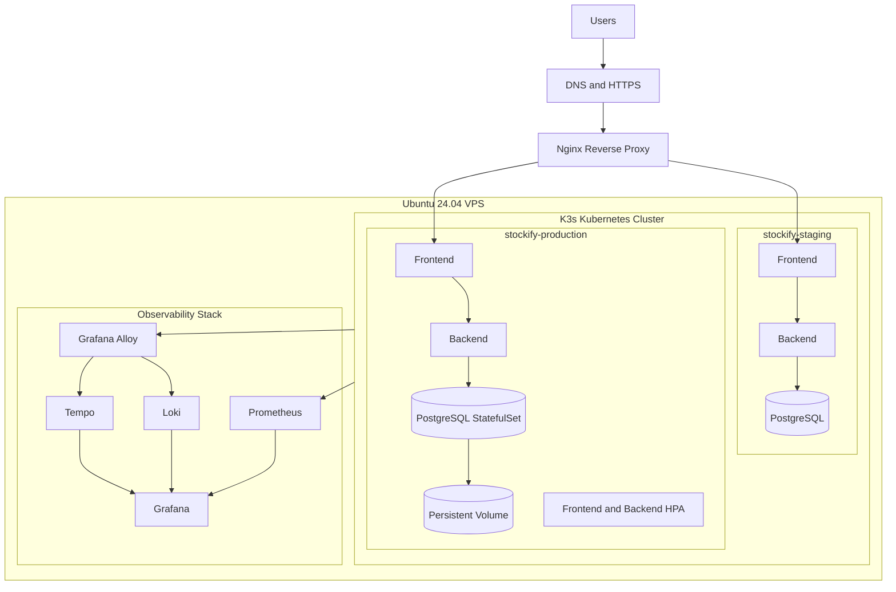
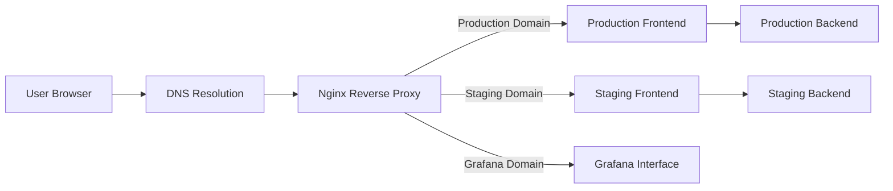
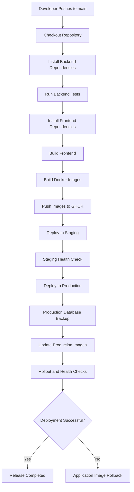
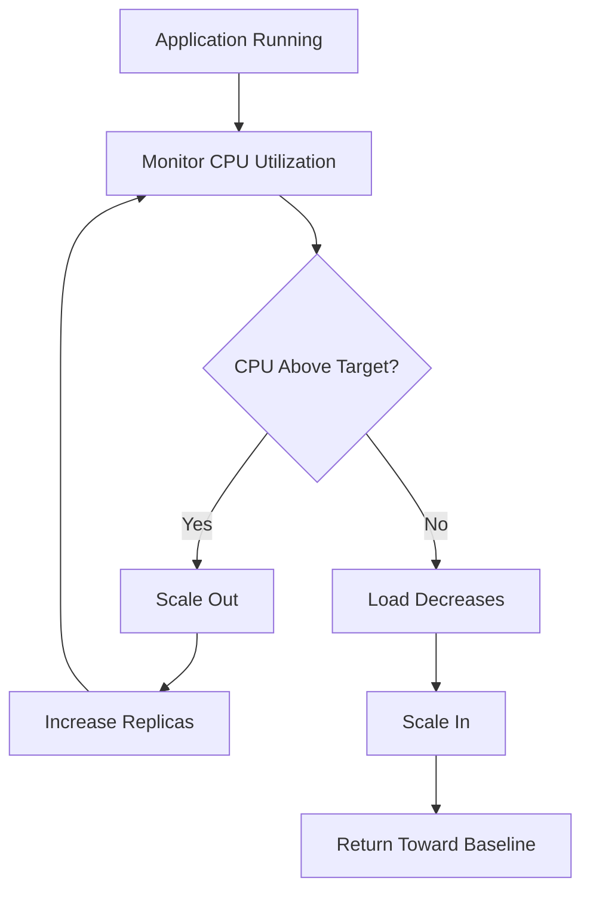
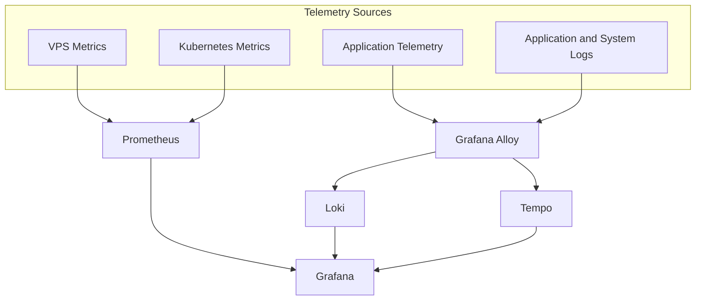
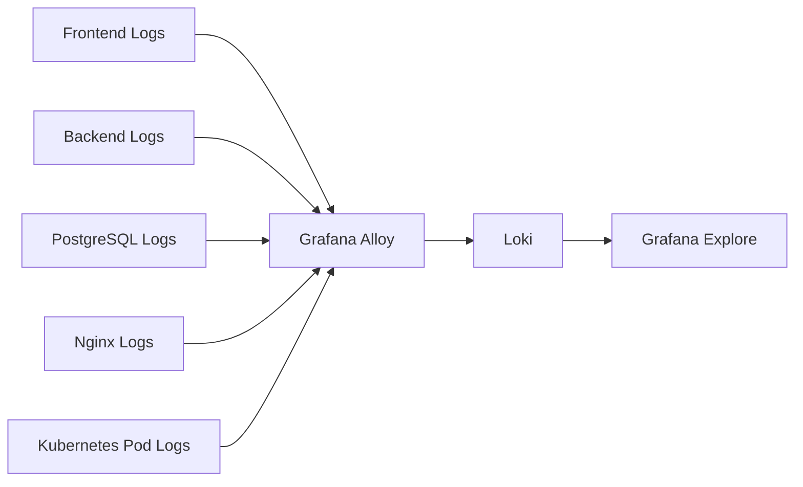
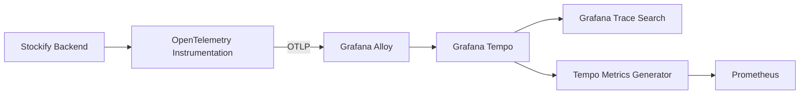
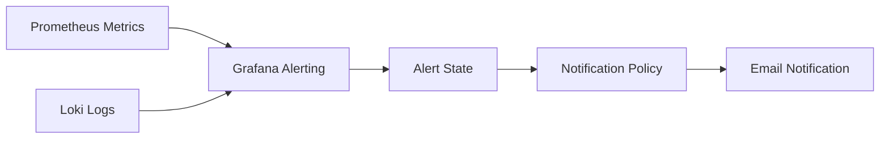

# Stockify
## End-to-End DevOps Implementation

Stockify is a web-based Inventory Management System designed to simplify inventory operations through centralized product management, stock movement tracking, inventory analytics, and role-based access control.

This project implements an end-to-end DevOps workflow covering application development, containerization, Kubernetes orchestration, automated CI/CD, infrastructure monitoring, centralized logging, distributed tracing, and application observability.

The application is deployed on an Ubuntu 24.04 VPS using K3s Kubernetes, with separate Staging and Production environments.

---

# Table of Contents

1. Project Overview
2. Application Overview
3. Technology Stack
4. Server Infrastructure
5. System Architecture
6. Production Environment
7. Staging Environment
8. Kubernetes Workload Management
9. Networking and Reverse Proxy
10. CI/CD Pipeline
11. Container Registry
12. Autoscaling and Load Testing
13. Observability Architecture
14. Infrastructure and Kubernetes Monitoring
15. Centralized Logging
16. Distributed Tracing
17. Application Observability
18. Alerting and Notifications
19. Security Implementation
20. Repository Structure
21. Application Access
22. Implementation Summary

---

# 1. Project Overview

Stockify is an Inventory Management System supported by an end-to-end DevOps implementation.

The project focuses on building a reliable application delivery process through automated testing, container image management, Kubernetes deployment, infrastructure monitoring, and application observability.

## Project Objectives

- Automate application testing and deployment.
- Implement containerization using Docker.
- Manage application workloads using K3s Kubernetes.
- Separate Staging and Production environments.
- Automate CI/CD using GitHub Actions.
- Store and distribute container images using GHCR.
- Implement automatic horizontal scaling using Kubernetes HPA.
- Monitor infrastructure and application performance.
- Centralize application and infrastructure logs.
- Implement distributed tracing using OpenTelemetry and Grafana Tempo.
- Improve deployment reliability through database backup and application rollback.

## Project Scope

| Area | Implementation |
|---|---|
| Application Development | React, Node.js, Express |
| Database | PostgreSQL |
| Containerization | Docker |
| Container Registry | GitHub Container Registry |
| Orchestration | K3s Kubernetes |
| Reverse Proxy | Nginx |
| CI/CD | GitHub Actions |
| Autoscaling | Kubernetes HPA |
| Metrics Monitoring | Prometheus |
| Visualization | Grafana |
| Telemetry Collection | Grafana Alloy |
| Centralized Logging | Loki |
| Distributed Tracing | OpenTelemetry and Tempo |

---

# 2. Application Overview

Stockify provides a centralized platform for managing inventory operations.

The application helps users manage product information, monitor stock availability, record stock movements, and analyze inventory activities.

## Core Features

### 2.1 Product Management

Provides centralized product management to organize and maintain inventory information.

### 2.2 Stock Movement

Records inventory movements to support stock tracking and transaction history.

### 2.3 Inventory Analytics

Provides inventory-related information to help users monitor stock conditions and inventory activities.

### 2.4 Role Management

Supports role-based access for different application users:

- Admin
- Warehouse Staff
- Manager

---

# 3. Technology Stack

The project uses the following technologies:

| Category | Technology | Description |
|---|---|---|
| Frontend | React | User interface development |
| Frontend Tooling | Vite | Frontend development and build tooling |
| Styling | Tailwind CSS | UI styling |
| Backend | Node.js | Backend runtime environment |
| API Framework | Express.js | REST API and application logic |
| Database | PostgreSQL | Relational database |
| Containerization | Docker | Application container images |
| Container Registry | GHCR | Container image storage |
| Orchestration | K3s | Kubernetes workload management |
| Reverse Proxy | Nginx | External traffic routing |
| CI/CD | GitHub Actions | Automated application delivery |
| Metrics | Prometheus | Metrics collection and storage |
| Visualization | Grafana | Monitoring dashboards |
| Telemetry Collector | Grafana Alloy | Telemetry collection and forwarding |
| Log Storage | Loki | Centralized log storage |
| Distributed Tracing | Grafana Tempo | Trace storage and exploration |
| Instrumentation | OpenTelemetry | Application telemetry instrumentation |
| Operating System | Ubuntu 24.04 | VPS operating system |

---

# 4. Server Infrastructure

Stockify is deployed on a VPS running Ubuntu Server 24.04 LTS.

The VPS hosts the K3s cluster, application workloads, reverse proxy, and observability infrastructure.

## Server Specification

| Component | Configuration |
|---|---|
| Operating System | Ubuntu Server 24.04 LTS |
| CPU | 2 vCPU |
| Memory | 4 GB RAM |
| Container Runtime | containerd |
| Orchestration | K3s |
| Reverse Proxy | Nginx |
| Firewall | UFW |
| SSH Protection | Fail2Ban |

## Infrastructure Components

| Component | Function |
|---|---|
| Ubuntu Server | Hosts the infrastructure |
| K3s | Runs Kubernetes workloads |
| Nginx | Routes external application traffic |
| PostgreSQL | Stores application data |
| PersistentVolumeClaim | Provides persistent database storage |
| Kubernetes Services | Enables internal workload communication |
| HPA | Automatically scales application replicas |
| UFW | Controls network access |
| Fail2Ban | Protects SSH access against repeated failed login attempts |

---

# 5. System Architecture

Stockify uses a single-node K3s Kubernetes cluster to manage both Staging and Production workloads.

Each environment is separated using a dedicated Kubernetes namespace.

Nginx acts as the external reverse proxy and routes incoming HTTPS traffic to the appropriate application environment.

## Architecture Diagram



## Architecture Explanation

1. Users access Stockify through the application domains.
2. DNS resolves the requested domain to the VPS.
3. Nginx receives HTTPS traffic and routes requests to the appropriate environment.
4. Kubernetes Services provide stable network endpoints for application workloads.
5. The frontend communicates with the backend API.
6. The backend communicates with PostgreSQL.
7. PostgreSQL stores application data.
8. Prometheus collects infrastructure and application metrics.
9. Grafana Alloy collects and forwards telemetry.
10. Loki stores centralized logs.
11. Tempo stores distributed traces.
12. Grafana provides dashboards and observability interfaces.

**Infrastructure topology:** Staging and Production are namespace-isolated but share the same VPS and K3s node. This architecture does not provide node-level high availability.

---

# 6. Production Environment

Production is deployed on K3s Kubernetes inside the namespace:

`stockify-production`

The Production environment contains the application workloads, database, persistent storage, and autoscaling configuration.

## Production Workloads

| Workload | Kubernetes Resource | Purpose |
|---|---|---|
| Frontend | Deployment | Runs the production web interface |
| Backend | Deployment | Handles API requests and application logic |
| Frontend | Service | Exposes frontend workload |
| Backend | Service | Provides internal API communication |
| PostgreSQL | StatefulSet | Runs the production database |
| PostgreSQL Storage | PersistentVolumeClaim | Provides persistent database storage |
| Frontend HPA | HorizontalPodAutoscaler | Scales frontend replicas |
| Backend HPA | HorizontalPodAutoscaler | Scales backend replicas |

## Production Frontend

The frontend is deployed as a Kubernetes Deployment.

Its responsibilities include:

- Serving the Stockify web interface.
- Handling user interactions.
- Communicating with the backend API.
- Providing the application interface to Production users.

The frontend is exposed through a Kubernetes NodePort Service and routed through Nginx.

## Production Backend

The backend is deployed as a Kubernetes Deployment.

Its responsibilities include:

- Processing application requests.
- Handling business logic.
- Communicating with PostgreSQL.
- Providing API endpoints.
- Generating application telemetry through OpenTelemetry instrumentation.

The backend is exposed internally through a ClusterIP Service.

## Production Database

PostgreSQL runs as a StatefulSet.

The database uses persistent storage through a PersistentVolumeClaim.

| Configuration | Value |
|---|---|
| Workload | StatefulSet |
| Database | PostgreSQL |
| Storage Request | 5Gi |
| Storage Type | PersistentVolumeClaim |

Persistent storage helps retain database data beyond the lifecycle of an individual database pod.

## Production Deployment Strategy

Production deployment follows these steps:

1. Verify the application build and container images.
2. Connect to the VPS through restricted Production SSH access.
3. Execute the Production deployment script.
4. Create a PostgreSQL backup.
5. Update backend and frontend image versions.
6. Wait for Kubernetes rollout completion.
7. Perform application health checks.
8. Attempt to restore previous application image versions if deployment fails.

Production application workloads are deployed using K3s, not Docker Compose.

---

# 7. Staging Environment

Staging is deployed inside the Kubernetes namespace:

`stockify-staging`

Staging provides an environment for validating application changes before they are deployed to Production.

## Staging Workloads

| Workload | Kubernetes Resource | Purpose |
|---|---|---|
| Frontend | Deployment | Runs the Staging web interface |
| Backend | Deployment | Runs the Staging API |
| PostgreSQL | Deployment | Runs the Staging database workload |
| PostgreSQL Storage | PersistentVolumeClaim | Provides database storage |
| Frontend | Service | Exposes Staging frontend |
| Backend | Service | Internal API communication |
| PostgreSQL | Service | Internal database communication |

## Staging Deployment Flow

1. A developer pushes changes to the `main` branch.
2. GitHub Actions executes backend tests.
3. GitHub Actions builds the frontend.
4. Docker images are built and published to GHCR.
5. The Staging deployment script updates Kubernetes image versions.
6. Kubernetes performs the rollout.
7. The application health endpoint is checked.
8. Production deployment proceeds after the Staging job succeeds.

## Staging Purpose

Staging is used to:

- Validate application changes.
- Verify deployment behavior.
- Check application availability.
- Detect potential deployment issues before Production release.

---

# 8. Kubernetes Workload Management

Kubernetes manages the lifecycle of Stockify application workloads.

The cluster uses Deployments, Services, StatefulSets, PersistentVolumeClaims, Namespaces, and HorizontalPodAutoscalers.

## 8.1 Kubernetes Namespaces

Namespaces separate application resources between environments.

| Namespace | Environment |
|---|---|
| `stockify-staging` | Staging |
| `stockify-production` | Production |

## 8.2 Deployments

Deployments manage frontend and backend application pods.

They provide:

- Replica management.
- Container image updates.
- Rolling updates.
- Pod replacement.
- Deployment rollout status.

## 8.3 Services

Kubernetes Services provide stable network endpoints for application communication.

The project uses:

- ClusterIP for internal service communication.
- NodePort for configured frontend exposure.

## 8.4 StatefulSet

Production PostgreSQL uses a StatefulSet to maintain stable database workload identity and persistent storage association.

## 8.5 PersistentVolumeClaim

PersistentVolumeClaims provide persistent storage for database workloads.

| Environment | PVC Request |
|---|---:|
| Staging | 2Gi |
| Production | 5Gi |

The actual underlying filesystem capacity reported by kubelet should not be confused with the requested PVC capacity.

## 8.6 Resource Management

Kubernetes resource requests and limits are configured for application workloads.

These settings help manage CPU and memory allocation within the cluster.

---

# 9. Networking and Reverse Proxy

Nginx is used as the reverse proxy for Stockify.

It manages incoming application traffic and routes requests based on the requested domain.

## Application Domains

| Environment | Domain |
|---|---|
| Production | https://stockify.web.id |
| Staging | https://staging.stockify.web.id |
| Grafana | https://grafana.stockify.web.id |

## Request Routing



## Networking Components

| Component | Purpose |
|---|---|
| DNS | Resolves application domains |
| HTTPS | Secures external communication |
| Nginx | Reverse proxy |
| Kubernetes Services | Internal workload communication |
| ClusterIP | Internal service access |
| NodePort | Configured frontend exposure |
| UFW | Network access control |

Nginx handles external routing, while Kubernetes Services provide internal communication between application components.

---

# 10. CI/CD Pipeline

Stockify implements Continuous Integration and Continuous Deployment using GitHub Actions.

The pipeline automates application validation, container image publishing, and deployment to Kubernetes.

## CI/CD Architecture



## 10.1 Continuous Integration

The CI job performs application validation.

Activities include:

- Repository checkout.
- Node.js environment setup.
- Backend dependency installation.
- Backend automated tests.
- Frontend dependency installation.
- Frontend production build.

The deployment pipeline continues only after the CI job succeeds.

## 10.2 Container Image Build

The pipeline builds two application images:

- Stockify Backend.
- Stockify Frontend.

Docker Buildx is used to build the images.

## 10.3 Container Image Publishing

The generated images are published to GitHub Container Registry.

Images use the Git commit SHA as their version tag.

This allows deployments to reference a specific application revision.

## 10.4 Staging Deployment

The Staging deployment job:

1. Connects to the VPS using the Staging SSH credential.
2. Invokes the restricted Staging deployment wrapper.
3. Updates the Kubernetes image versions.
4. Waits for deployment rollout.
5. Performs application health checks.

## 10.5 Production Deployment

Production deployment runs after successful Staging deployment.

The Production job:

1. Prepares the Production SSH connection.
2. Executes the restricted Production deployment command.
3. Transfers the version-controlled Production deployment script.
4. Installs the script on the VPS.
5. Creates a PostgreSQL backup.
6. Updates backend and frontend images.
7. Waits for Kubernetes rollouts.
8. Performs health checks.
9. Attempts application image rollback if deployment fails.

## Deployment Policy

The current GitHub Actions workflow deploys Production automatically after Staging succeeds.

Production deployment uses restricted SSH access and a GitHub Environment configuration. It is not currently configured as a manual approval gate.

---

# 11. Container Registry

Stockify uses GitHub Container Registry (GHCR) to store and distribute Docker images.

## Published Images

| Image | Description |
|---|---|
| `ghcr.io/jayyidjidan/stockify-backend` | Backend application |
| `ghcr.io/jayyidjidan/stockify-frontend` | Frontend application |

## Image Versioning

Each deployment uses a Git commit SHA as its image tag.

Example:

```text
ghcr.io/jayyidjidan/stockify-backend:<commit-sha>
ghcr.io/jayyidjidan/stockify-frontend:<commit-sha>
```

Using commit SHA tags provides traceability between application source code, container images, and deployed Kubernetes workloads.

---

# 12. Autoscaling and Load Testing

Stockify Production uses Kubernetes Horizontal Pod Autoscaler (HPA) to automatically adjust application replica counts based on CPU utilization.

## HPA Configuration

| Configuration | Value |
|---|---|
| Minimum Replicas | 1 |
| Maximum Replicas | 3 |
| CPU Utilization Target | 70% |
| Backend HPA | Enabled |
| Frontend HPA | Enabled |

## Autoscaling Behavior



## Load Testing Validation

CPU stress testing was performed to validate HPA behavior.

Observed behavior:

1. The application starts with one replica.
2. CPU load is generated.
3. HPA detects increased CPU utilization.
4. Replicas scale from one to three.
5. CPU load is removed.
6. Replicas return toward the baseline.

This validates CPU-based autoscaling behavior.

The CPU stress test should be distinguished from HTTP request-based load testing.

---

# 13. Observability Architecture

Observability provides visibility into the health and behavior of the application and infrastructure.

Stockify implements three main observability areas:

1. Metrics Monitoring.
2. Centralized Logging.
3. Distributed Tracing.

## Observability Stack

| Tool | Function |
|---|---|
| Prometheus | Metrics collection and storage |
| Grafana | Monitoring dashboards |
| Grafana Alloy | Telemetry collection and forwarding |
| Loki | Centralized log storage |
| Grafana Tempo | Distributed trace storage |
| OpenTelemetry | Application instrumentation |

## Observability Flow



---

# 14. Infrastructure and Kubernetes Monitoring

Prometheus collects infrastructure and Kubernetes metrics for monitoring and performance analysis.

Grafana visualizes the collected metrics through monitoring dashboards.

## 14.1 VPS / Host Metrics

Host-level monitoring provides information about VPS infrastructure.

Metrics include:

- CPU usage.
- Memory usage.
- Disk usage.
- Network traffic.

## 14.2 Container Metrics

Container monitoring provides information about resource utilization.

Metrics include:

- Container CPU usage.
- Container memory usage.
- Container resource consumption.

## 14.3 Kubernetes Resource Metrics

Kubernetes resource monitoring provides visibility into pod resource utilization.

Metrics include:

- Pod CPU usage.
- Pod memory usage.
- Container resource usage.
- Kubernetes workload resource consumption.

## 14.4 Kubernetes State Metrics

Kubernetes state monitoring provides information about workload conditions.

Metrics include:

- Pod status.
- Deployment replicas.
- Available replicas.
- Unavailable replicas.
- CrashLoopBackOff conditions.
- Namespace information.
- HPA status and resource metrics.

## 14.5 Storage Monitoring

Kubelet volume statistics are collected to provide visibility into volume usage.

Metrics include:

- Volume used bytes.
- Volume available bytes.
- Volume capacity statistics.

The reported underlying filesystem capacity must be interpreted carefully and should not be treated as the PVC request size.

## Grafana Monitoring Dashboards

The project includes:

- Stockify Infrastructure Monitoring.
- Stockify Kubernetes Monitoring.

These dashboards provide a centralized view of host resources, Kubernetes workloads, and infrastructure conditions.

---

# 15. Centralized Logging

Stockify uses Grafana Alloy and Loki to centralize application and infrastructure logs.

Grafana Alloy collects logs from supported sources and forwards them to Loki.

Grafana provides the interface for log exploration and analysis.

## Logging Architecture



## 15.1 Frontend Logs

Frontend logs provide information about web application requests and responses.

Examples include:

- HTTP requests.
- Accessed URLs and endpoints.
- HTTP response status.
- Client request information where collected.

## 15.2 Backend Logs

Backend logs provide information about API processing and application execution.

Examples include:

- API requests.
- Application errors.
- Database connection errors.
- Runtime exceptions.
- Request processing information.

## 15.3 PostgreSQL Logs

PostgreSQL logs provide database-related operational information.

Examples include:

- Database connection events.
- SQL errors.
- Database warnings.
- Checkpoint activity.
- Database operational messages.

## 15.4 Nginx Logs

Nginx logs provide information about external traffic and reverse proxy behavior.

Examples include:

- HTTP access logs.
- Request methods.
- Response status codes.
- Nginx error logs.

## 15.5 Kubernetes Pod Logs

Kubernetes pod logs provide container-level application output.

Sources include:

- Frontend pod logs.
- Backend pod logs.
- PostgreSQL pod logs.
- Container standard output.
- Container standard error.

## Centralized Logging Dashboard

Grafana provides centralized log exploration through Loki.

This allows application and infrastructure logs to be analyzed from a single monitoring interface.

---

# 16. Distributed Tracing

Stockify implements distributed tracing using OpenTelemetry, Grafana Alloy, and Grafana Tempo.

The backend application is instrumented to generate telemetry data for request tracing.

## Tracing Architecture



## Tracing Components

### OpenTelemetry

OpenTelemetry instruments the backend application to generate distributed tracing information.

### Grafana Alloy

Alloy receives telemetry through OTLP and forwards traces to Tempo.

### Grafana Tempo

Tempo stores distributed traces and supports trace exploration.

### Tempo Metrics Generator

Tempo generates additional metrics from collected traces.

These include:

- Span metrics.
- Service graph metrics.
- Request-related telemetry.
- Latency histogram metrics.

The generated metrics are made available to Prometheus.

## Distributed Tracing Dashboard

The Stockify Distributed Tracing dashboard includes:

1. Backend Trace Search.
2. Backend Error Traces.
3. Stockify Service Dependencies.

This dashboard helps investigate individual requests and understand service interactions.

---

# 17. Application Observability

Application Observability focuses on the performance and behavior of the Stockify backend.

The dashboard uses metrics generated from distributed tracing.

## 17.1 HTTP Request Rate

Measures the rate of backend server spans over a selected time range.

This provides visibility into application request activity.

## 17.2 HTTP Request Latency

Measures request latency using histogram-based percentile calculations.

The dashboard includes:

- P50 latency.
- P95 latency.
- P99 latency.

These percentiles help identify normal and high-latency requests.

## 17.3 Backend Span Error Rate

Measures the percentage of backend spans marked with an OpenTelemetry error status.

This provides a view of application-level tracing errors.

Note that OpenTelemetry span status errors are not automatically equivalent to HTTP 5xx responses.

## 17.4 Service Dependencies

Service graph metrics provide visibility into relationships between services.

This helps understand communication patterns and trace dependencies.

## Application Observability Dashboard

The dashboard includes:

- HTTP Request Rate.
- HTTP Request Latency.
- Backend Span Error Rate.

---

# 18. Alerting and Notifications

Grafana Alerting provides a mechanism for evaluating monitoring conditions and notifying administrators about potential infrastructure or application issues.

The project presentation documents the following alert categories.

## 18.1 Infrastructure and Kubernetes Alerts

| Alert Rule | Trigger Condition | Severity |
|---|---|---|
| Pod Failed | Pod enters a failed state | Critical |
| Pod Pending | Pod remains pending for 5 minutes | Warning |
| CrashLoopBackOff | Container repeatedly fails to start | Critical |
| Deployment Unavailable | Deployment has unavailable replicas | Critical |
| High CPU Usage | CPU exceeds 800 mCPU for 5 minutes | Warning |

## 18.2 Application and Logging Alerts

| Alert Rule | Purpose |
|---|---|
| Backend Application Error | Detects backend application errors |
| PostgreSQL Error | Detects database errors |
| Nginx HTTP 5xx | Detects HTTP 5xx responses from Nginx |
| Stockify Frontend HTTP 5xx | Detects frontend HTTP 5xx responses |

## 18.3 Alert Notification Flow



## Alert States

- **Pending:** An alert condition has been detected but has not yet satisfied its firing duration.
- **Firing:** The alert condition has been met.
- **Resolved:** The alert condition is no longer active.

Notification policies determine how alerts are routed to configured notification channels.

The listed rules describe the alert design documented in the project presentation. Verify the live Grafana rules and notification configuration before treating every rule as currently active.

---

# 19. Security Implementation

Security is implemented across the VPS, SSH access, application deployment, and Kubernetes configuration.

## 19.1 Host Security

- Ubuntu Server 24.04.
- UFW firewall.
- Fail2Ban SSH protection.

## 19.2 SSH Deployment Security

GitHub Actions uses dedicated SSH deployment credentials.

The deployment keys are restricted through SSH forced-command wrappers.

Separate wrappers are configured for:

- Staging deployment.
- Production deployment.

The wrappers only allow approved deployment commands.

This prevents GitHub Actions deployment credentials from being used as unrestricted shell access.

## 19.3 Application Secrets

Application credentials are stored using Kubernetes Secrets.

Sensitive credentials must not be committed to the Git repository.

## 19.4 Production Backup and Rollback

Before Production application deployment, the deployment process creates a PostgreSQL backup.

If application deployment fails, the script attempts to restore the previous backend and frontend image versions.

Database backup and application image rollback are separate recovery mechanisms.

---

# 20. Repository Structure

The repository is organized into application source code, Kubernetes configuration, deployment scripts, and GitHub Actions workflows.

```text
Stockify/
│
├── backend/
│   └── Express API source code
│
├── frontend/
│   └── React application source code
│
├── k8s/
│   ├── staging/
│   │   └── Staging Kubernetes manifests
│   │
│   ├── production/
│   │   └── Production Kubernetes manifests
│   │
│   └── loadtest/
│       └── Load testing resources
│
├── scripts/
│   └── deployment/
│       └── deploy-production.sh
│
├── .github/
│   └── workflows/
│       └── ci-cd.yml
│
└── README.md
```

---

# 21. Application Access

The following endpoints provide access to the deployed application and monitoring interface.

| Platform | URL |
|---|---|
| Stockify Production | https://stockify.web.id |
| Stockify Staging | https://staging.stockify.web.id |
| Grafana Monitoring | https://grafana.stockify.web.id |
| GitHub Repository | https://github.com/jayyidjidan/Stockify |
| GitHub Actions | https://github.com/jayyidjidan/Stockify/actions |

---

# 22. Implementation Summary

Stockify demonstrates an end-to-end DevOps implementation covering the complete application delivery and operational monitoring lifecycle.

## Implemented Capabilities

| Area | Implementation |
|---|---|
| Application | React, Express, PostgreSQL |
| Containerization | Docker |
| Container Registry | GHCR |
| Orchestration | K3s Kubernetes |
| Environment Separation | Staging and Production namespaces |
| Networking | Nginx Reverse Proxy |
| CI/CD | GitHub Actions |
| Deployment | Automated K3s deployment |
| Autoscaling | Kubernetes HPA |
| Metrics | Prometheus |
| Dashboards | Grafana |
| Log Collection | Grafana Alloy |
| Log Storage | Loki |
| Distributed Tracing | OpenTelemetry and Tempo |
| Security | UFW, Fail2Ban, restricted SSH deployment |
| Recovery | PostgreSQL backup and application image rollback |

## Final Result

The Stockify project establishes an automated and observable application delivery platform.

Application changes are validated through Continuous Integration, packaged into versioned container images, deployed to Staging, and subsequently deployed to Production through Kubernetes.

Prometheus, Grafana, Alloy, Loki, and Tempo provide monitoring and observability across infrastructure and application workloads.

The implementation demonstrates practical DevOps capabilities in:

- Application containerization.
- Kubernetes orchestration.
- Automated CI/CD.
- Environment separation.
- Horizontal autoscaling.
- Infrastructure monitoring.
- Centralized logging.
- Distributed tracing.
- Application observability.
- Deployment security and recovery.

---

**Project:** Stockify  
**Implementation:** End-to-End DevOps  
**Repository:** https://github.com/jayyidjidan/Stockify
